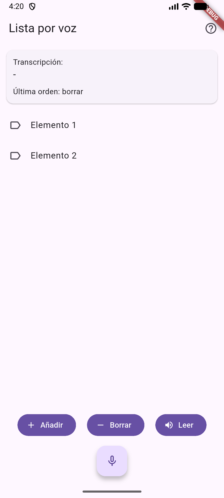
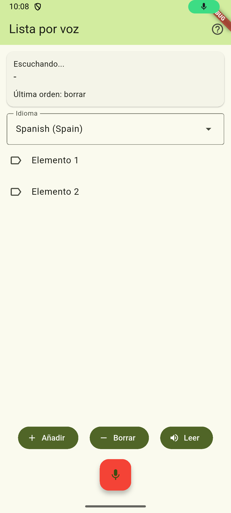

# Actividad 1 · Lista controlada por voz

App en Flutter con una lista que se maneja con la voz. Pulsas el micro, dices una orden (añadir, borrar, leer o ayuda) y la app la hace y te contesta hablando. Todo lo que se hace con la voz también se puede hacer con los botones.

## Ficheros
- `lib/comandos.dart`: el enum `Comando` y la función `interpretarComando()`. Es Dart puro para poder hacerle tests.
- `lib/main.dart`: la pantalla, el reconocimiento de voz (`speech_to_text`) y la voz de respuesta (`flutter_tts`).
- `test/comandos_test.dart`: 8 tests del intérprete de órdenes.

## Cómo probarlo
```bash
flutter test test/comandos_test.dart
flutter run
```

## Reflexión

### 1. ¿El reconocimiento va en el dispositivo o en un servidor?
No tengo móvil Android, así que la app la he probado en el emulador de Android Studio (Medium Phone, API 37), que el enunciado deja usar. La prueba del modo avión no la he podido hacer bien: en el emulador el micro se activa y sale «Escuchando...», pero no he conseguido que le llegue mi voz, así que no puedo decir si reconoce sin internet.

Lo que sí sé es cómo funciona: `speech_to_text` no reconoce la voz por sí mismo, usa el servicio de reconocimiento que tenga el móvil (en Android normalmente el de Google). Por eso hay que poner `RecognitionService` en `<queries>` y el permiso de `INTERNET`. Si el móvil tiene descargado el idioma para usar sin conexión, reconoce en el propio móvil; si no, manda el audio a los servidores de Google.

- **Privacidad:** si va en el móvil, el audio no sale de él. Si va por servidor, mi voz se envía a una empresa de fuera.
- **Coste:** a la app no le cuesta nada porque usa el servicio del sistema. Si usara un servicio en la nube de pago, cada orden costaría dinero.
- **Latencia:** en local responde rápido siempre. Por servidor depende de la conexión, y con mala cobertura tarda o falla.
- **Plataforma:** depende de cada móvil (si tiene servicio de voz y el idioma descargado). En un móvil sin servicio de voz el micro sale deshabilitado.

### 2. Situaciones en las que no se puede usar la voz
1. **Sitios con ruido o donde hay que estar callado**, como clase, la biblioteca o el autobús. Para eso están los botones Añadir, Borrar y Leer, que hacen lo mismo que la voz.
2. **Si no hay permiso de micro o el móvil no tiene servicio de voz** (o el usuario tiene problemas para hablar). El micro sale en gris con un texto que explica por qué, y la app se sigue usando con los botones.

## Capturas (emulador Android)
| Botones Añadir/Borrar | Micro escuchando |
|---|---|
|  |  |
