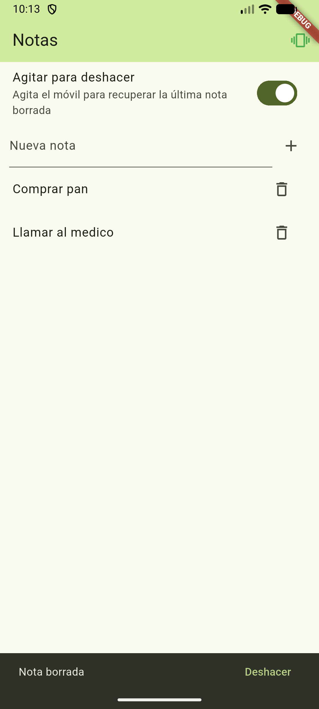
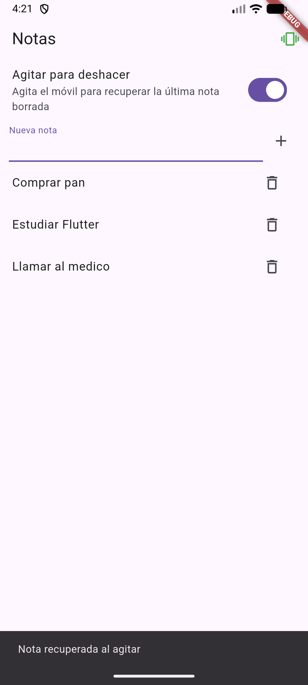

# Actividad 2 · Agitar para deshacer

App de notas. Cuando borras una nota sale «Nota borrada» con el botón «Deshacer», y si agitas el móvil también se recupera en el mismo sitio donde estaba. Lo de agitar se puede desactivar con un interruptor.

## Ficheros
- `lib/detector_agitado.dart`: la clase `DetectorAgitado` (Dart puro).
- `lib/main.dart`: la lista de notas, el `Dismissible`, los SnackBar y el sensor (`sensors_plus`).
- `test/detector_agitado_test.dart`: 5 tests (reposo, sacudida, otra sacudida dentro de la pausa, otra pasada la pausa y un umbral distinto).

## Cómo probarlo
```bash
flutter test test/detector_agitado_test.dart
flutter run
```
En el emulador: *Extended controls › Virtual sensors* y mover el móvil virtual.

## Reflexión

### 1. Umbral elegido
No tengo móvil Android, así que no he podido hacer la prueba de caminar con el móvil en la mano. La app la he probado en el emulador simulando una sacudida con los sensores virtuales (unos 30 m/s² en el eje x), y con el umbral de 15 recupera la nota borrada y sale «Nota recuperada al agitar».

Sin la prueba real, me quedo con **15 m/s²**, que es el que viene por defecto:
- **10** me parece muy bajo: al andar o al mover el brazo rápido se puede pasar de 10 y se recuperaría una nota sin querer.
- **25** es demasiado alto: habría que agitar muy fuerte y a algunas personas les costaría.
- **15** está en medio: hace falta agitar a propósito, pero sin pasarse.

### 2. ¿Por qué `userAccelerometerEventStream` y no `accelerometerEventStream`?
`accelerometerEventStream` cuenta también la gravedad, así que con el móvil quieto en la mesa ya marca unos 9,8 m/s² (en el eje z). `userAccelerometerEventStream` quita la gravedad y en reposo da casi 0, así que solo mide el movimiento que hace la persona. Con el normal, estando quieto ya estarías cerca del umbral y con cualquier movimiento pequeño saltaría la sacudida.

### 3. Condiciones de WCAG 2.5.4 (Activación mediante movimiento) que cumple la app
1. **Lo mismo se puede hacer sin mover el móvil:** el botón «Deshacer» del SnackBar recupera la nota sin agitar.
2. **El movimiento se puede desactivar:** con el interruptor «Agitar para deshacer» la app deja de escuchar el sensor, y así no se activa sin querer.

## Capturas (emulador Android)
La sacudida la simulé con los sensores virtuales del emulador.

| Nota borrada (con Deshacer) | Nota recuperada al agitar |
|---|---|
|  |  |
